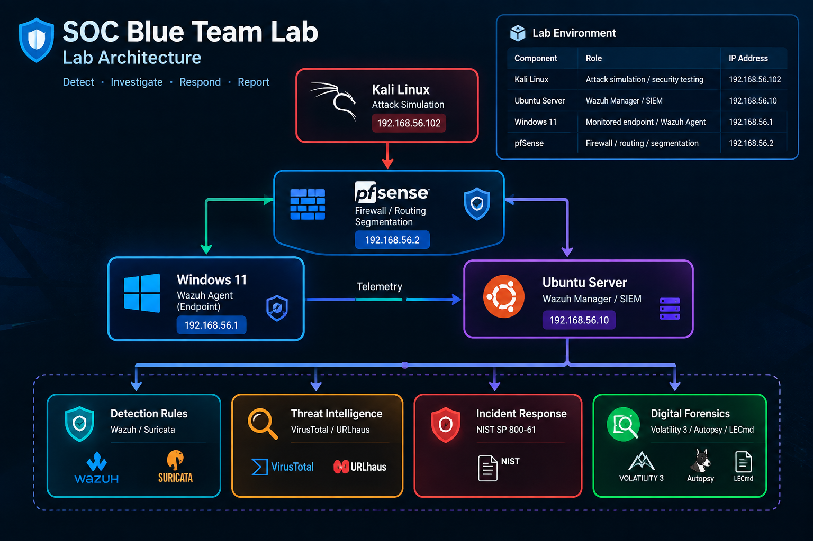
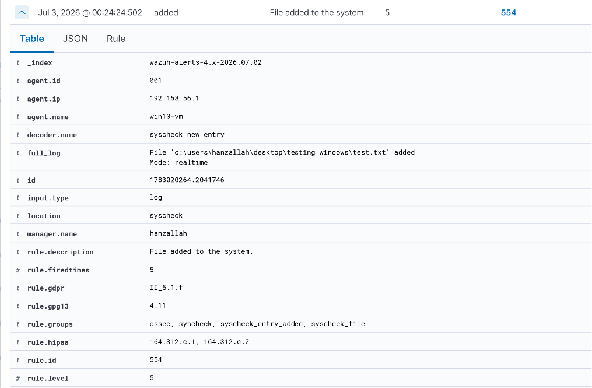
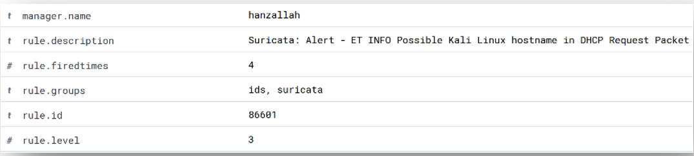
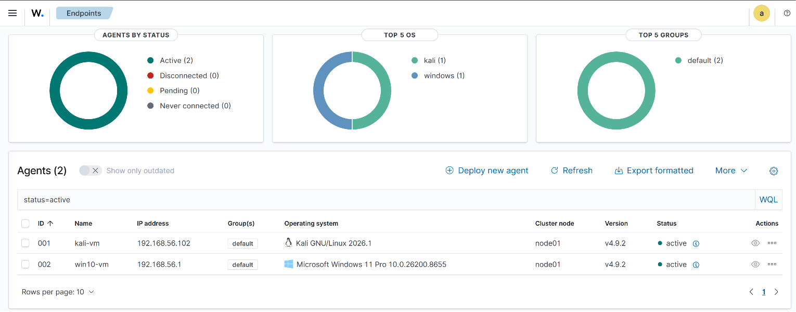
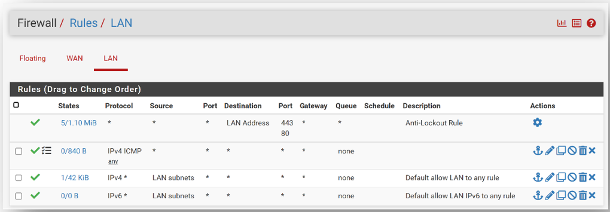
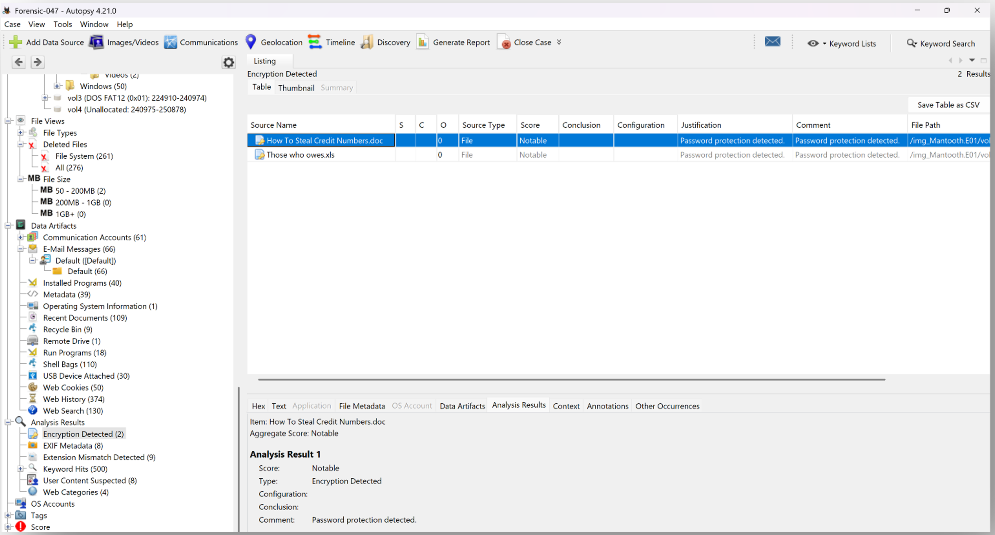

<h1 align="center">🛡️ SOC Blue Team Lab</h1>

<p align="center">
<b>Telemetry → Detection → Investigation → Threat Intel → Incident Response → Forensics</b><br>
Built during a 90-day SOC Analyst internship at Cyberster (Batch 2)
</p>

<p align="center">


</p>

---

## 📖 Summary

A multi-VM SOC lab that follows an attack through the full blue-team pipeline: endpoint telemetry, custom detections, investigation, threat-intel enrichment, incident response (NIST SP 800-61) and forensics.

It was built week by week rather than from a single tutorial. Every failure along the way (a silent rule, a broken integration, a VM that wouldn't boot) is documented with its root cause and fix.

**Stack:** Wazuh · Suricata · pfSense · VirusTotal · URLhaus · Volatility 3 · Autopsy · Wireshark · Kali · Windows 11 · Ubuntu

---

## 🖥️ Lab Architecture



| Component | Role |
|---|---|
| Kali Linux | Attack simulation |
| Ubuntu Server | Wazuh Manager / SIEM |
| Windows 11 | Monitored endpoint (Wazuh agent) |
| pfSense | Firewall, routing, segmentation |

The lab began on a flat VirtualBox host-only network and was later routed through pfSense so inter-VM traffic is filtered and segmented.

---

## 🎯 Detection Showcase

Custom detections written and validated in the lab. Rule files are in [`03-Detection-Engineering`](./03-Detection-Engineering).

| Rule | Engine | MITRE ATT&CK | How it was triggered |
|---|---|---|---|
| `1000001` Nmap SYN scan | Suricata | T1046 | `nmap -sS` from Kali |
| `1000002` HTTP directory traversal | Suricata | T1190 | Request with `../../../` in the URI |
| `1000003` ICMP flood | Suricata | T1498 | High-rate ICMP echo from Kali |
| `100001` New user account created | Wazuh | T1136 | `useradd` on the Linux endpoint |
| `100002` SSH brute force (6+ failures / 2 min) | Wazuh | T1110 | Repeated failed SSH logins |
| `100003` USB device inserted | Wazuh | T1091 | Device plugged into Windows 11 |
| `100300` Known-malicious IP (Abuse.ch) | Wazuh + threat intel | n/a | Traffic matching a feed IOC |
| `100210` `.b64` staging in `C:\Espionage` | Wazuh FIM | T1027 | Created an encoded file in the monitored folder |

**Evidence**





<details>
<summary>📸 Wazuh agent monitoring</summary>



</details>

---

## 🧪 Notable Findings

### 1. Silent Wazuh FIM detection failure

**Symptom:** the custom FIM rule loaded, the manager was running and the ruleset was valid, but modifying the monitored file produced **zero alerts**.

**Root cause:** the rule matched a field that doesn't exist in the event. Found by comparing the raw alert JSON with the rule conditions.

```diff
 <rule id="100210" level="10">
   <if_sid>550</if_sid>
-  <field name="file">C:\\Espionage\\.*\.b64$</field>
+  <field name="syscheck.path">C:\\Espionage\\.*\.b64$</field>
   <description>Suspicious .b64 file in C:\Espionage - possible exfiltration staging</description>
   <mitre><id>T1027</id></mitre>
 </rule>
```

| | Before | After |
|---|---|---|
| Service status | Running | Running |
| Ruleset check | Valid | Valid |
| Alert on file change | ❌ None | ✅ Rule `100210` fires |

**Lesson:** a clean restart proves nothing about matching. Validate rules against the raw event fields, not the config.

### 2. VirusTotal API v2 → v3 integration

Wazuh 4.14.5's bundled `virustotal.py` targets the deprecated v2 endpoint, which fails against valid v3 keys. Patched it to use the v3 endpoint with header-based authentication, and documented it as a visibility-gap finding. Enrichment now works end to end.

### 3. pfSense would not boot on VirtualBox

The VM refused to enter 64-bit long mode because Hyper-V held exclusive access to VT-x. Fixed by setting VirtualBox's paravirtualization interface to Hyper-V and correcting the guest OS type to 64-bit FreeBSD.

<details>
<summary>📸 pfSense firewall rules</summary>



</details>

---

## 🔎 Investigations

| Area | Work | Folder |
|---|---|---|
| Incident Response | NIST SP 800-61 IR reports, insider-threat simulation (staging, encoding, exfiltration, deletion), CyberChef decoding | [`06-Incident-Response`](./06-Incident-Response) |
| Digital Forensics | Browser, LNK and USB artifacts; Volatility 3 memory capstone; Autopsy disk analysis (`.E01`) | [`07-Digital-Forensics`](./07-Digital-Forensics) |
| Threat Intelligence | VirusTotal v3 and URLhaus enrichment, IOC/IOA extraction, ATT&CK mapping | [`05-Threat-Intelligence`](./05-Threat-Intelligence) |

<details>
<summary>📸 Forensic analysis</summary>



</details>

---

## 📂 Repository Structure

| Folder | Contents |
|---|---|
| [`01-Lab-Setup`](./01-Lab-Setup) | VM builds, networking, base configuration |
| [`02-Wazuh-Deployment`](./02-Wazuh-Deployment) | Agent enrollment, FIM, event log monitoring |
| [`03-Detection-Engineering`](./03-Detection-Engineering) | Custom Wazuh and Suricata rules |
| [`04-Network-Segmentation`](./04-Network-Segmentation) | pfSense setup, routing, firewall rules |
| [`05-Threat-Intelligence`](./05-Threat-Intelligence) | VirusTotal, URLhaus, MITRE mapping |
| [`06-Incident-Response`](./06-Incident-Response) | IR reports, insider-threat simulation |
| [`07-Digital-Forensics`](./07-Digital-Forensics) | Browser/LNK/USB forensics, Volatility 3 capstone |
| [`docs-archive`](./docs-archive) | Raw week-by-week internship reports |

---

## 🧠 Skills Demonstrated

- **SIEM & detection engineering:** Wazuh deployment, FIM, custom MITRE-mapped rules, Active Response (`firewall-drop` on SSH brute force)
- **Network security:** Suricata (af-packet, custom rules, offline PCAP replay), pfSense segmentation, GeoIP blocking (ipset/iptables), Wireshark (ARP, DNS, HTTP, QUIC, ICMPv6)
- **Threat intelligence & malware analysis:** VirusTotal v3, Abuse.ch/URLhaus, ANY.RUN sandbox, IOC extraction
- **Incident response:** NIST SP 800-61 playbooks, evidence collection, containment, reporting
- **Digital forensics:** Volatility 3, Autopsy, LECmd, browser/LNK/USB artifacts

---

## 🔗 Background

Completed as part of the **Cyberster SOC Analyst Internship (Batch 2)**. Weekly progress was also documented on [LinkedIn](https://www.linkedin.com/in/hanzallah-io/).

## 📄 License

Released under the [MIT License](LICENSE).

## 👨‍💻 Author

**Muhammad Hanzallah**, BS Data Science | Blue Team / SOC Analyst

[GitHub](https://github.com/hanzallah-io) · [LinkedIn](https://www.linkedin.com/in/hanzallah-io/)
